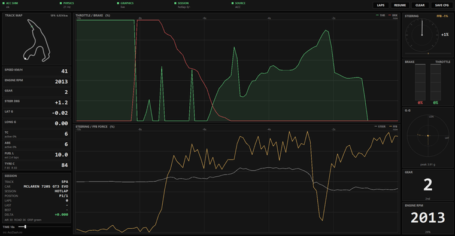
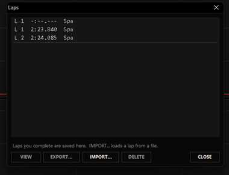
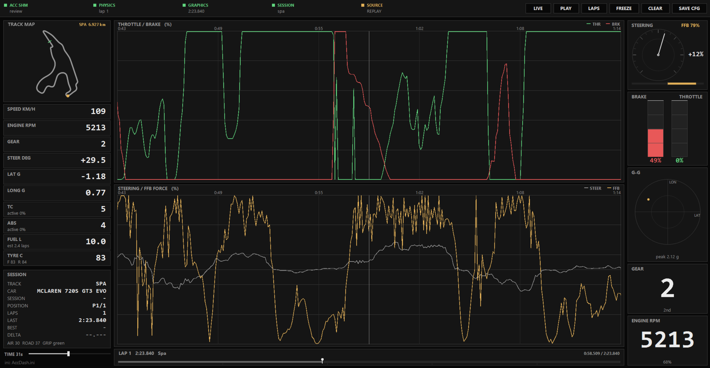

# ACC Telemetry Dashboard

<b>中文</b> | <a href="README_EN.md">English</a>

> Assetto Corsa Competizione 遥测面板 —— 实时看数据、录圈、回放、学赛道图。

## 功能

- **实时数据**：速度、转速、档位、转向、踏板、G 值、圈速、名次、油量、胎温胎压、赛道与天气
- **曲线**：油门/刹车、转向/FFB 两条滚动曲线，时间窗可调
- **仪表**：方向盘表盘、踏板柱、G-G 圆盘、档位与转速大数字、SESSION 信息卡
- **赛道地图**：跑一圈自动画出赛道轮廓并保存，之后直接读取；实时显示车辆位置
- **单圈录像**：过起点线自动开录、过线结束；视频嵌在单圈文件里，回放与图表同步
- **圈速列表**：回放、导出、导入、删除
- **DELTA 对比**：任选同赛道的一圈作参考，显示整圈差值曲线与当前差值
- **回放控制**：播放/暂停、长按 8 倍速、拖动进度条、调整时间窗
- **状态灯**：共享内存、物理/图形页、SESSION、数据源、REC 录制状态

## 快速开始

1. 双击 `AccDash.exe`
2. 启动 ACC 并进入赛道，顶部状态灯变绿即已连接

视频功能需要 `ffmpeg`（放在 `ffmpeg\bin\` 下即可，发布包已包含）。

## 截图

## 快捷键

| 键 | 作用 |
| --- | --- |
| `F2` | 冻结 / 恢复数据 |
| `F3` | 清空曲线 |
| `F4` | 保存配置 |
| `F5` | 打开圈速列表 |
| `F6` | 退出回放，回到实时 |
| `Space` | 回放播放 / 暂停 |
| `F11` | 全屏切换 |

## 说明

- 第一次跑新赛道需要两圈：出站圈过后开始记录，下一圈过线时闭合保存
- 单圈文件 `.accdash` 自带数据与视频，可以直接分享
