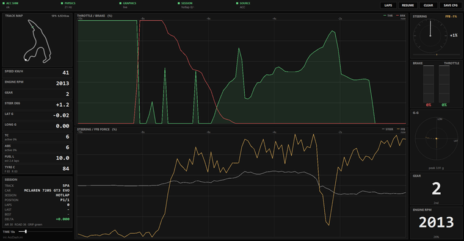
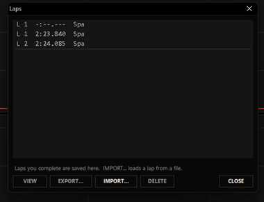
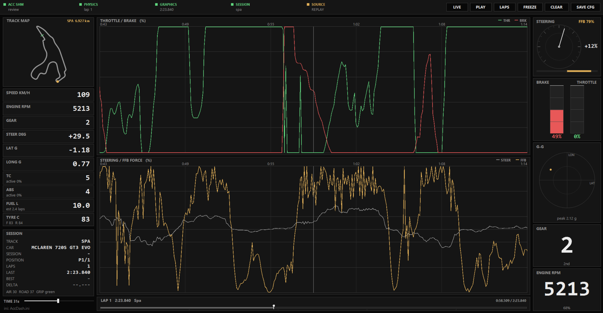

# ACC Telemetry Dashboard

<p align="right"><a href="README.md">中文</a> | <b>English</b></p>

> Telemetry dashboard for Assetto Corsa Competizione

> Reads ACC shared memory to show live data, record laps, replay them and learn track maps

---

<p align="center"></p>

## Quick start

1. Double-click `AccDash.exe`
2. Start ACC and enter a session - the dashboard connects by itself; wait for the status LEDs at the top to turn green

---

## Project layout

```
acc-dash\
  AccDash.exe          the program
  AccDash.ini          window settings
  build.cmd            build script
  tracks\              track outlines
  assets\
    app.ico               application icon
    icon-256.png          icon source image
  src\
    Program.cs           entry point
    Interop.cs           Win32 P/Invoke, palette Pal
    Model.cs             Fmt formatting, Ring buffer, Snap snapshot, Clock
    Shm.cs               ACC shared-memory structs and the AccShm reader
    Config.cs            reads / writes AccDash.ini
    Dash.cs              main window: fields, constructor, three-column widgets
    Dash.Layout.cs       column layout and window-size adaptivity
    Dash.Runtime.cs      timer, Tick loop, opening / closing shared memory
    Dash.Render.cs       pushes the snapshot into the widgets
    Dash.Laps.cs         lap recording, lap list, entering / leaving replay
    Dash.Map.cs          track-map learning, closing, saving, resuming
    Ui\Drawing.cs        fonts, drawing helper G, widget base class Pane
    Ui\Widgets.cs        data tile, status lamp, flat button
    Ui\Charts.cs         traces, steering gauge, pedal bars, G-G disc, big numbers, SESSION panel
    Ui\Slider.cs         TIME slider
    Laps\LapData.cs      lap samples, LapData, .accdash file format
    Laps\LapBrowser.cs   lap list control and the LAPS dialog
    Track\TrackOutline.cs outline polyline and .map file format
    Track\TrackMap.cs    left-column track map widget
```

---

## Keyboard shortcuts


| Key     | Action                          |
| --------- | ------------------------------- |
| `F2`    | freeze / resume data (FREEZE)   |
| `F3`    | clear the charts                |
| `F4`    | save AccDash.ini                |
| `F5`    | open the lap list               |
| `F6`    | leave replay, back to live      |
| `Space` | replay play / pause             |
| `F11`   | toggle full screen              |

---

## Laps: record, export, import, replay

<p align="center"></p>

<p align="center"></p>

- Every time you cross the start line a lap starts recording; crossing it again stores the lap in the in-memory list
- `LAPS` or `F5` opens the list: `VIEW` replays a lap, `EXPORT...` saves it as `.accdash`, `IMPORT...` loads one from a file, `DELETE` removes it
- In replay: both charts show the whole lap and the progress bar at the bottom scrubs it; `PLAY` plays / pauses, holding `PLAY` fast-forwards at 8x; the `TIME` slider sets how wide the chart time window is
- `LIVE` returns to real time

---

## Track map

### How it learns

1. For a track that has no file under `tracks\`, recording starts when you cross the start line at the end of the out-lap; the next time you cross it the outline is closed, smoothed and saved as `tracks\<track>.map` - so in hotlap you need at least two laps
2. Later sessions read the existing file and never redraw it
3. An unclosed outline is saved every 15 seconds as `tracks\<track>.partial.map` and resumed on the next start
4. To relearn a track: quit the dashboard and delete the matching `.map` file

**Tracks learned so far: BRANDS HATCH, PAUL RICARD, ZANDVOORT, MISANO, SPA, BARCELONA, 24H NURB, HUNGARORING, MONZA, NURBURGRING, SILVERSTONE, ZOLDER**

---

## Configuration: AccDash.ini

```ini
[display]
TraceSeconds=10      ; chart time window, 3..60 s
SpeedUnit=kmh        ; kmh | mph
TempUnit=c           ; c | f
GScale=2.0           ; full scale of the G-G disc, 0.5..4.0 g
LongGSign=-1         ; -1 = braking is positive (default), +1 = braking is negative
```

Changes take effect after a restart. After moving a slider, press `F4` (or `SAVE CFG`) to write it back.

---

## Data source

Data comes from the three named shared-memory pages of ACC, mapped read-only and refreshed at about 30 Hz:

- `Local\acpmf_physics` - speed, RPM, gear, pedals, G loads, tyre temperatures, fuel, FFB output
- `Local\acpmf_graphics` - lap count, position, lap times, delta, sector, grip, weather
- `Local\acpmf_static` - track name, car model, max RPM

---

## Building

Requires the `csc.exe` that ships with .NET Framework 4.x on Windows. Just double-click `build.cmd`.

Manual equivalent:

```bat
for /r src %f in (*.cs) do @echo "%f">>sources.rsp
%WINDIR%\Microsoft.NET\Framework64\v4.0.30319\csc.exe /nologo /target:winexe /out:AccDash.exe /optimize+ ^
  /win32icon:assets\app.ico ^
  /r:System.dll /r:System.Core.dll /r:System.Drawing.dll /r:System.Windows.Forms.dll @sources.rsp
```

---